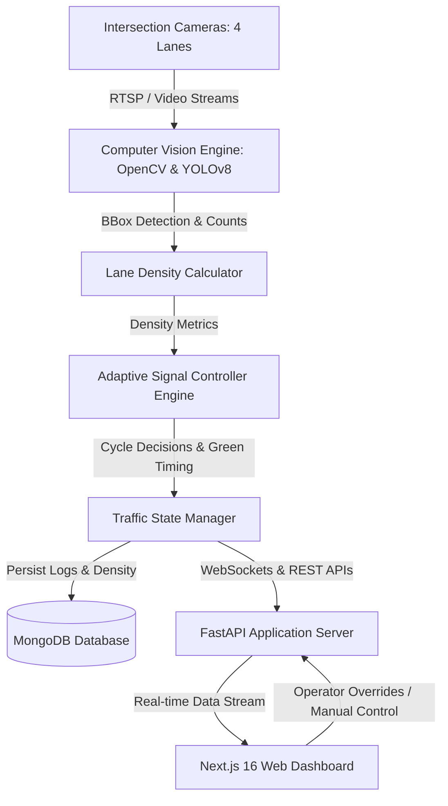
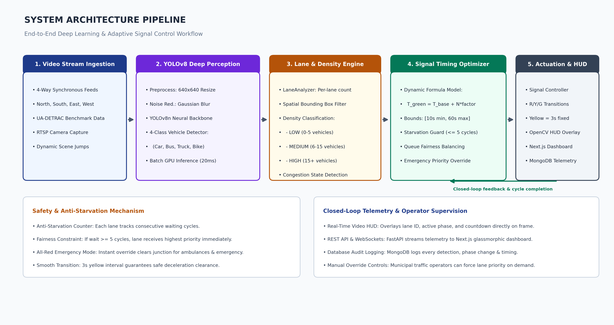
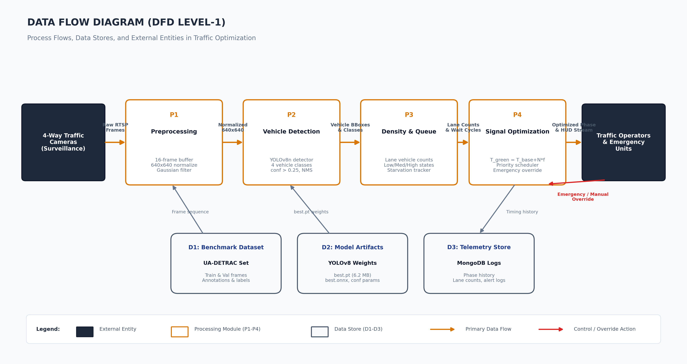

<div align="center">

# 🚦 Smart Traffic Signal Optimization System

### *An AI-Powered, Computer Vision-Driven Adaptive Urban Mobility & Traffic Management Platform*

[](https://www.python.org/)
[](https://fastapi.tiangolo.com/)
[](https://nextjs.org/)
[](https://react.dev/)
[](https://github.com/ultralytics/ultralytics)
[](https://opencv.org/)
[](https://www.mongodb.com/)
[](LICENSE)

<br />

**Eliminate intersection congestion, prioritize emergency services, and minimize commuter wait times through real-time vehicle density analysis and dynamic signal timing.**

[Explore Dashboard](http://localhost:3000/dashboard) · [Report Bug](https://github.com/sarvaghnakishore/Smart-Traffic-Signal-Optimization-System/issues) · [Request Feature](https://github.com/sarvaghnakishore/Smart-Traffic-Signal-Optimization-System/issues)

</div>

---

## 📋 Table of Contents
- [Overview](#-overview)
- [Key Features](#-key-features)
- [System Architecture](#-system-architecture)
- [Tech Stack](#-tech-stack)
- [Directory Structure](#-directory-structure)
- [Getting Started](#-getting-started)
  - [Prerequisites](#prerequisites)
  - [Backend Setup](#1-backend-setup)
  - [Frontend Setup](#2-frontend-setup)
- [API Reference](#-api-reference)
- [Presentation & Research Deck](#-presentation--research-deck)
- [Authors & Team](#-authors--team)
- [License](#-license)

---

## 🌟 Overview

Conventional traffic signal systems rely on rigid, fixed-time schedules or rudimentary magnetic induction loops that fail to adapt to dynamic urban traffic variations. The **Smart Traffic Signal Optimization System** resolves this by integrating high-precision deep learning (**YOLOv8**) and real-time computer vision (**OpenCV**) directly into intersection signal controllers.

By processing multi-lane live video streams simultaneously, the system evaluates real-time queue density, computes dynamic green signal intervals based on current demand, facilitates emergency vehicle preemption, and streams telemetry to an interactive web dashboard.

---

## ✨ Key Features

- **🎯 Real-Time Multi-Lane Detection**: Processes 4-way intersection camera feeds (*North, South, East, West*) with YOLOv8 to identify and track cars, trucks, buses, and motorcycles.
- **⏱️ Dynamic Green Light Allocation**: Calculates signal duration adaptively using live density metrics rather than predetermined fixed timers.
- **🚨 Emergency Vehicle Preemption**: Instant priority override for ambulances, fire engines, and police vehicles with automated safety clearance cycles.
- **📡 Low-Latency Telemetry & WebSockets**: Real-time signal countdowns, lane densities, and junction states pushed directly to connected dashboards.
- **📊 Comprehensive Analytics Suite**: Historical congestion curves, average wait times, lane comparison charts, and automated incident logs powered by MongoDB.
- **🕹️ Manual Dispatcher Override**: Full administrative control for traffic operators to manually hold, advance, or adjust phase cycles in real time.
- **📽️ MJPEG Live Video Feeds**: Low-latency video streaming with bounding box overlays and lane-specific detection zones.

---

## 🏗️ System Architecture



### High-Level Architecture & DFD

<div align="center">
  
  <p><em>Figure 1: High-Level System Architecture and Processing Pipeline</em></p>
</div>

<br />

<div align="center">
  
  <p><em>Figure 2: Data Flow Diagram (DFD) — Camera Ingestion to Signal Optimization</em></p>
</div>

---

## 🛠️ Tech Stack

| Domain | Technology | Purpose |
|---|---|---|
| **Frontend Framework** | [Next.js 16](https://nextjs.org/) (App Router) | High-performance dashboard & SSR pages |
| **UI Library** | [React 19](https://react.dev/) | Component architecture & reactive state |
| **Styling** | [Tailwind CSS v4](https://tailwindcss.com/) | Modern responsive design & dark-mode styling |
| **Visualizations** | [Chart.js](https://www.chartjs.org/) & [Recharts](https://recharts.org/) | Real-time traffic flow & wait-time analytics |
| **Icons** | [Lucide React](https://lucide.dev/) | Clean, accessible iconography |
| **Backend Framework** | [FastAPI](https://fastapi.tiangolo.com/) | Asynchronous, high-throughput REST & WebSocket API |
| **Computer Vision** | [Ultralytics YOLOv8](https://github.com/ultralytics/ultralytics) + [OpenCV](https://opencv.org/) | Object detection, vehicle classification & tracking |
| **Database** | [MongoDB](https://www.mongodb.com/) / [PyMongo](https://pymongo.readthedocs.io/) | NoSQL storage for density telemetry & signal history |
| **Presentation Engine** | [python-pptx](https://python-pptx.readthedocs.io/) | Automated slide deck & architecture deck builder |

---

## 📁 Directory Structure

```plaintext
Smart-Traffic-Signal-Optimization-System/
├── backend/
│   ├── app/
│   │   ├── core/                  # Intersection manager, pipeline & classes
│   │   ├── models/                # Pydantic & database schemas
│   │   ├── routes/                # FastAPI routes (traffic, analytics)
│   │   ├── services/              # Signal logic, density, junction services
│   │   ├── config.py              # System configuration
│   │   ├── database.py            # MongoDB connection handler
│   │   └── main.py                # FastAPI application entrypoint
│   ├── ml_pipeline/               # YOLOv8 training, preprocessing & data scripts
│   ├── audit.py                   # Performance & inference latency auditing
│   ├── requirements.txt           # Python dependencies
│   └── run.py                     # Backend startup script
├── frontend/
│   ├── app/
│   │   ├── analytics/             # Historical metrics & report views
│   │   ├── dashboard/             # Real-time junction monitoring dashboard
│   │   ├── layout.tsx             # Root layout & navigation shell
│   │   └── page.tsx               # Landing redirect
│   ├── components/                # Modular UI components (Camera, Signals, Charts)
│   ├── styles/                    # Global styling & Tailwind configurations
│   ├── package.json               # Frontend dependencies & scripts
│   └── tsconfig.json              # TypeScript configuration
├── ppt_assets/                    # High-resolution architecture & DFD diagrams
├── build_presentation.py          # Automated 16-slide PowerPoint generator
├── generate_diagrams.py           # Programmatic diagram generator
├── .gitignore                     # Git exclusion rules (datasets, caches, node_modules)
└── README.md                      # Project documentation
```

---

## 🚀 Getting Started

### Prerequisites
- **Python**: `3.10` or higher
- **Node.js**: `18.x` or higher (`npm` or `pnpm`)
- **MongoDB**: Community Server running locally on default port `27017` (or MongoDB Atlas URI)

---

### 1. Backend Setup

```bash
# 1. Navigate to the backend directory
cd backend

# 2. (Recommended) Create and activate a virtual environment
python -m venv .venv
# On Windows:
.venv\Scripts\activate
# On Linux/macOS:
source .venv/bin/activate

# 3. Install dependencies
pip install -r requirements.txt

# 4. Start the FastAPI backend server
python run.py
```
> The API server will boot up at `http://localhost:8000`. You can inspect interactive Swagger documentation at `http://localhost:8000/docs`.

---

### 2. Frontend Setup

```bash
# 1. Open a new terminal and navigate to the frontend directory
cd frontend

# 2. Install dependencies
npm install

# 3. Launch the development server
npm run dev
```
> The application dashboard will be accessible at: **[http://localhost:3000/dashboard](http://localhost:3000/dashboard)**

---

## 📡 API Reference

### Traffic & Signal Control (`/traffic`)
| Method | Endpoint | Description |
|---|---|---|
| `GET` | `/traffic/state` | Retrieve real-time state for all active lanes |
| `GET` | `/traffic/density` | Get current vehicle density calculations |
| `GET` | `/traffic/video_feed/{lane_id}` | Live MJPEG video stream with bounding boxes |
| `POST` | `/traffic/override` | Dispatch manual phase or emergency preemption |
| `WS` | `/traffic/ws` | Real-time WebSocket connection for live telemetry |

### Analytics & Historical Reports (`/analytics`)
| Method | Endpoint | Description |
|---|---|---|
| `GET` | `/analytics/history` | Historical traffic density time-series records |
| `GET` | `/analytics/signals` | Historical green phase durations and wait times |
| `GET` | `/analytics/summary` | Aggregated metrics, peak congestion hours & logs |
| `GET` | `/analytics/alerts` | System alerts and emergency override notifications |

---

## 📑 Presentation & Research Deck

This repository includes a script that automatically generates a comprehensive 16-slide PowerPoint review deck with dark and light theme layouts:

```bash
# Rebuild the presentation at any time
python build_presentation.py
```
*Output*: Generates `Smart_Traffic_Signal_Optimization_Review.pptx` ready for defense and academic presentations.

---

## 👥 Authors & Team

<table align="center">
  <tr>
    <td align="center" width="50%">
      <br />
      <sub><b>G. Sarvaghna Reddy</b></sub><br />
      <a href="mailto:SarvaghnaKishore@gmail.com">SarvaghnaKishore@gmail.com</a><br />
      <a href="https://github.com/sarvaghnakishore">GitHub Profile</a>
    </td>
    <td align="center" width="50%">
      <br />
      <sub><b>B. Chandana</b></sub><br />
      <span>Project Collaborator</span><br />
      <span>CSE Department</span>
    </td>
  </tr>
</table>

---

## 📜 License

This project is licensed under the [MIT License](LICENSE) — feel free to use, modify, and distribute for academic and commercial purposes.
